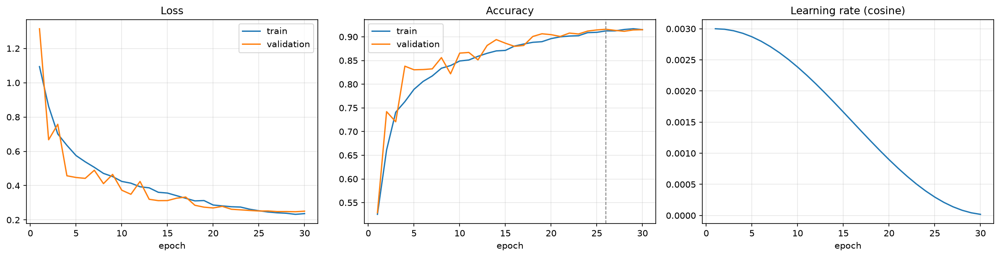
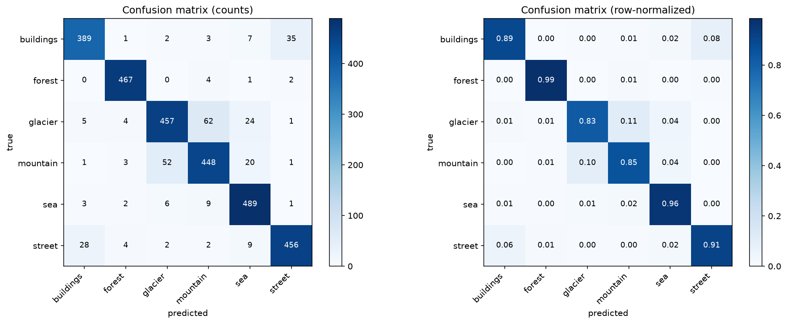
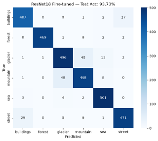

# intel-scene-classification
CNN from Scratch vs ResNet18 Transfer Learning on Intel Image Classification


# 🌄 Intel Scene Classification
### CNN from Scratch vs. Transfer Learning (ResNet18)

[](https://python.org)
[](https://pytorch.org)
[](https://gradio.app)
[](LICENSE)

A PyTorch project that trains and compares two image classification approaches on the
[Intel Image Classification](https://www.kaggle.com/datasets/puneet6060/intel-image-classification)
dataset: a custom CNN built from scratch (**SceneCNN**) and fine-tuned **ResNet18** via
transfer learning.

---

## 📊 Key Results

| Model | Params | Epochs | Test Accuracy | Macro F1 | Error Reduction |
|---|---|---|---|---|---|
| SceneCNN (from scratch) | 1.17 M | 30 | 90.20% | 0.9034 | — |
| ResNet18 (transfer learning) | 11.18 M | 15 (5+10) | **93.73%** | **0.9383** | **↓ 36%** |

ResNet18 reached **89.63% accuracy in epoch 1** (with frozen backbone) — a level
SceneCNN needed ~15 full epochs to reach.

---

## 🗂 Project Structure

```
intel-scene-classification/
├── 01_data_preparation.ipynb   # EDA, preprocessing, SceneCNN training
├── 02_transfer_learning.ipynb  # ResNet18 two-phase fine-tuning & evaluation
├── app.py                      # Gradio demo — run both models side-by-side
├── requirements.txt
├── models/                     # Checkpoint directory (generated by notebooks)
│   └── .gitkeep
└── outputs/                    # Training curves, confusion matrices, metrics
    ├── curves_scratch.png
    ├── confusion_matrix_scratch.png
    └── ...
```

---

## 📁 Dataset

Download the **Intel Image Classification** dataset from Kaggle and place it so the
notebooks can find it:

```
kaggle datasets download -d puneet6060/intel-image-classification
```

Expected folder layout after extraction:

```
data/
├── seg_train/   (14,034 images — 6 classes)
├── seg_test/    (3,000  images)
└── seg_pred/    (optional unlabeled)
```

**Classes:** `buildings` · `forest` · `glacier` · `mountain` · `sea` · `street`

---

## ⚙️ Installation

```bash
# 1. Clone the repository
git clone https://github.com/YOUR_USERNAME/intel-scene-classification.git
cd intel-scene-classification

# 2. Create a virtual environment (recommended)
python -m venv venv
source venv/bin/activate        # Linux / macOS
venv\Scripts\activate           # Windows

# 3. Install dependencies
pip install -r requirements.txt
```

---

## 🚀 Usage

### Run the notebooks in order

```bash
jupyter notebook
```

1. **`01_data_preparation.ipynb`** — Loads the dataset, performs EDA,
   builds and trains SceneCNN (30 epochs). Saves checkpoint to `models/`.
2. **`02_transfer_learning.ipynb`** — Loads ResNet18, applies two-phase
   fine-tuning, evaluates both models on the test set. Saves checkpoint to `models/`.

### Launch the Gradio app

After training (both `.pt` / `.pth` files must exist in `models/`):

```bash
python app.py
```

Open `http://127.0.0.1:7860` in your browser. Upload any scene image to
get Top-3 predictions and inference time from both models simultaneously.

---

## 🏗 Architecture

### SceneCNN — Built from scratch

```
Input (3×224×224)
  → ConvBlock × 4  [Conv-BN-ReLU → Conv-BN-ReLU → MaxPool]
     Channels: 3→32→64→128→256
  → AdaptiveAvgPool2d(1)          # Global average pooling
  → Dropout(0.4) → Linear(256, 6)
```

Training: `AdamW` · `CosineAnnealingLR` (T_max=30) · Mixed precision · ~31 min

### ResNet18 — Transfer learning

**Phase 1 (5 epochs):** Backbone fully frozen · only `fc` trained · LR 1e-3  
**Phase 2 (10 epochs):** `layer4` + `fc` unfrozen · discriminative LR (1e-4 / 5e-4)

---

## 📈 Results

### Training Curves — SceneCNN



### Confusion Matrices

| SceneCNN | ResNet18 |
|---|---|
|  |  |

### Per-class F1 Score

| Class | SceneCNN | ResNet18 | Δ F1 |
|---|---|---|---|
| buildings | 0.9015 | 0.9271 | +0.026 |
| forest | 0.9780 | 0.9936 | +0.016 |
| glacier | 0.8526 | 0.9002 | **+0.048** |
| mountain | 0.8509 | 0.9035 | **+0.053** |
| sea | 0.9226 | 0.9662 | +0.044 |
| street | 0.9147 | 0.9392 | +0.025 |

The hardest class pairs — `glacier/mountain` and `buildings/street` — showed
the largest gains from transfer learning.

---

## 🔬 Key Findings

1. **Pre-trained features transfer exceptionally well** to natural scene classification.
   ResNet18 surpassed SceneCNN's final accuracy in its very first epoch with a
   completely frozen backbone.

2. **Two-phase fine-tuning is critical.** Phase 1 alone gave 90.92%; unlocking
   `layer4` with discriminative learning rates added another ~3.1 percentage points.

3. **Most errors cluster in two class pairs.** Over 68% of SceneCNN's mistakes
   fall in `glacier↔mountain` and `buildings↔street` — pairs with genuine semantic
   overlap. Transfer learning reduced these errors the most.

4. **SceneCNN is competitive at 9.5× fewer parameters.** 90.20% accuracy with
   1.17 M params makes it a viable choice for edge deployment or memory-constrained
   environments.

---

## 📋 Requirements

- Python 3.10+
- CUDA-capable GPU recommended (CPU inference works but is slow)
- ~2 GB disk space for the dataset

---

## 🙏 Acknowledgements

Dataset: [Intel Image Classification](https://www.kaggle.com/datasets/puneet6060/intel-image-classification) by Puneet Bansal on Kaggle.
